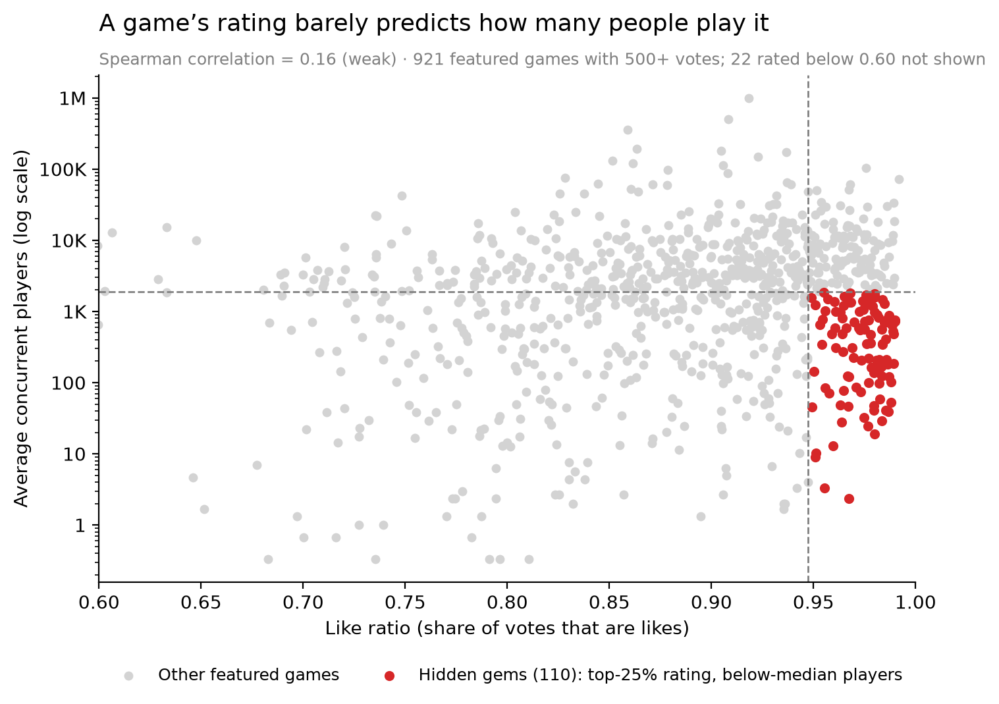

# Roblox Discovery: Do Great Games Get Found?
By Marcus Andriano

**Finding:** On Roblox, a game's rating barely predicts how many people play it (Spearman 0.16 across 921 featured games). 110 top-rated games sit below median players, while the top 10 games hold 38% of all players.

**Proposal:** A personalized Discovery Queue on Home that saves slots for highly rated, low-player games, tested with an A/B experiment. [Read the one-page proposal](proposal.pdf)



## Key results

| Question | Result |
|---|---|
| How concentrated are players? | Top 10 of 942 games hold 38% of players; top 100 hold 72%; Gini 0.81 |
| Can new games break in? | Yes. Games under 6 months old hold 39% of players; 16 of the top 50 are new |
| Does quality lead to players? | Barely. Rating vs. players Spearman correlation = 0.16 |
| Are hidden gems new games? | Mostly not. Only 22% of the 110 hidden gems are under 6 months old |
| Does Roblox surface new games? | Yes, in Up-and-Coming (94 of 94 new), but not where quality is the gap |

## Data

- **Source:** Roblox's public web APIs. The Explore API gives the Charts rows and their games; the Games API gives player counts, visits, votes, and created and updated dates.
- **Collection:** 3 snapshots (Oct 18–19, 2026, at different times of day) to reduce time-of-day noise. 942 unique experiences across 26 Charts rows. File timestamps are in UTC.
- **Genres:** Roblox's own genre field was "All" for 79% of games, so genres were labeled from the "Trending in ___" Charts rows (497 of 942 games).

## Limitations

- Only games Roblox already featured are included, so games that were never featured are invisible.
- 3 snapshots over about 2 days, during Halloween season.
- Like ratios are unreliable for small games, so rating analysis uses games with 500+ votes.
- Genre analysis covers only labeled games, which skew more popular.

## Repo

```
roblox_pull.py               data collection script
notebook/01_explore.ipynb    cleaning, analysis, charts, takeaways
charts/                      final charts
data/raw/                    untouched API pulls
data/clean/games.csv         one row per game with derived columns
proposal.pdf                 one-page feature proposal
log.md                       dated project log
```

## Reproduce

```
pip install pandas numpy requests matplotlib statsmodels
python roblox_pull.py
```

Then run `notebook/01_explore.ipynb` top to bottom. New pulls will give different numbers, since Charts change daily.
